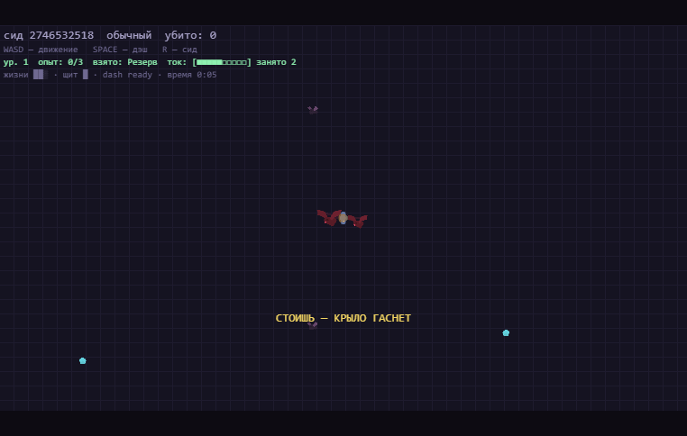

# Pixel Action Roguelike

Пиксельный экшн-рогалик в духе Vampire Survivors, но **без оружия у игрока**: весь урон наносят
**фигуры** (турели, духи, моты-стаи, дрон-мины), а игрок занят другим — добывает **Ток** и
управляет вниманием врагов. Чтобы кормить фигуры, надо двигаться: батареи и осколки лежат там,
куда приходится идти под огнём.



**Стек:** Phaser 4 · TypeScript (strict) · Vite · тесты на `node --test` без единой тестовой
зависимости. Звук — синтез осциллятором, без аудиофайлов.

## Петля забега

```
двигаешься → собираешь батареи и осколки → кормишь Ток → фигуры работают → убиваешь →
берёшь карты → ветка становится профессией → забег ускоряется → умираешь → медаль → новый забег
```

Виды врагов требуют разного (погоняла держит кольцо, танка надо расстреливать, стрелка — догонять,
делителя — добивать до подхода), элиты читаются обводкой, смерть — накопление трёх ошибок, а не
одного касания. Два режима (хардкор и обычный) держат разные таблицы результатов.

## Как запустить

Нужен **Node 22+**:

```
npm install
npm run dev      # игра на http://127.0.0.1:5173
```

Собрать готовый к передаче пакет (один HTML-файл, работает без Node и интернета):

```
npm run build    # dist/index.html + «Играть.bat» — запуск двойным кликом
```

Игра полностью автономна: движок, код и спрайты вшиты в `dist/index.html`, поэтому она
запускается прямо из файла (file://) — на любом компьютере и на телефоне.

## Управление

| Действие | ПК | Телефон |
|---|---|---|
| Движение | WASD / стрелки | стик в левой половине экрана |
| Рывок | SPACE | кнопка справа внизу |
| Новый забег | R (или тап на экране смерти) | тап на экране смерти |
| Режим (обычный/хардкор) | 1 / 2 на экране смерти | тап по строке режима |
| Звук | M | — |
| Выбор таланта | 1–3 или клик | тап |

## Разработка

```
npm test              # 111 тестов за ~2 с, без браузера
npm run typecheck
node tools/qa/file-launch-smoke.mjs   # смоук: сборка запускается из файла, мир живой, консоль чиста
```

Как устроен проект и почему именно так — в [PROJECT.md](PROJECT.md): архитектура, разбор каждого
модуля, контракты дизайна и ревью кода. История тринадцати плейтестов с замерами баланса — в
[PLAYTEST.md](PLAYTEST.md). Стенд замеров ботом — в [tools/bot/README.md](tools/bot/README.md).

## Структура

```
src/config/    все числа и данные (tuning, спрайты, виды врагов)
src/core/      чистая логика без браузера: прогрессия, мета, история, телеметрия
src/sim/       фиксированный шаг симуляции 120 Гц
src/systems/   Ток, снабжение, спавн, цели, броня, снаряды, ввод, звук
src/entities/  враги (машина состояний) и фигуры (четыре роли)
src/scenes/    GameScene — связка всего, HUD, экран смерти
tools/         стенд замеров ботом, смоук-тест упаковки, упаковщик
```

## Качество

- 111 тестов на все чистые модули: от опыта за танка до терпимого разбора сохранений.
- Стенд бота гоняет настоящую сцену сотнями прогонов по сидам — баланс решается замерами,
  а не ощущениями (как это делалось в [PLAYTEST.md](PLAYTEST.md)).
- Смоук-тест запускает собранный пакет из file:// в headless Chrome и проверяет, что игра живёт.

## Ассеты

Графика — CC0-наборы [Kenney](https://kenney.nl) (`moreenemiesanimations`, `topdown-shooter`,
`abstract-platformer`); атрибуция не требуется, источник зафиксирован в
[public/assets/CREDITS.md](public/assets/CREDITS.md).
